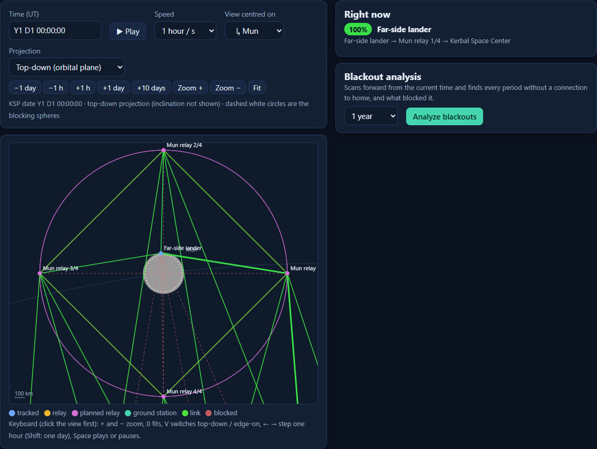

# KSP CommNet Workbench

[](https://github.com/slammingprogramming/ksp-commnet-calculator/actions/workflows/ci.yml)
[](LICENSE)

**Use it online: <https://slammingprogramming.github.io/ksp-commnet-calculator/>**

A web app for planning Kerbal Space Program's CommNet. It started as a replacement for a CommNet calculator
spreadsheet and grew into a workbench: calculate signal strength, chain relays, find antennas, **track orbits in
time, see exactly when and why a link is blocked, and design relays that fix the cause instead of the symptom**. It also
plans missions and career saves: rockets from your `.craft` files, delta-v, costs, research and upgrades.

Built for **KSP 1.12.5** (stock, Breaking Ground, Outer Planets Mod, plus several antenna mods). No install, no
account, nothing leaves your browser.

<p align="center">
  
</p>

## What it does

| Tab | Use it to |
|---|---|
| **Link & relay chain** | Build DSN → relay → probe chains with range, distance and signal per hop, plus a direct-link check. |
| **Antenna finder** | Enter a distance and target signal; get the minimal antenna combinations, lightest, cheapest or fewest parts first. |
| **Reach map** | See the signal at every body, with an optional line-of-sight simulation for landers. |
| **Scenario** | Define the vessels, bases and relays to follow; import your real fleet from a save. |
| **Tracker** | Watch bodies, orbits, links and blocking spheres move, and list every blackout with its start, duration and cause. |
| **Relay planner** | Diagnose *why* a vessel loses contact and design, check and stress-test the relays that fix it, within a budget if you like. |
| **Network** | See who can reach whom over time, find the relays everything depends on, and compare ground-station sets (including the Making History ones). |
| **Network plan** | List your stations, labs, bases, mines, rovers and aircraft and get a relay network built in stages (or all at once) from what your career has unlocked, with what to unlock next, what it costs, where to put stations and bases, and where to earn the science. |
| **Reentry** | Find when and where a landing loses signal to plasma, and the speed you can come in at without losing it. |
| **Launch windows** | Find when to leave for another planet or moon, and how much speed it takes. |
| **Career** | Plan a career save: money, science and reputation over time, facility upgrades with their real prices, the research order to a goal, the science each experiment is worth. |
| **Missions** | Import your `.craft` rockets, build a route (launch, transfer, landing, return) and see whether the rocket can do it, what it needs and what it does to your funds. |
| **Landing** | Find landing sites by how much tilt you can land on and stay on, latitude, height, biome and distance; see each body's biomes, what a lander can measure there, and the Breaking Ground instruments and rocks. |
| **Antennas & mods** | Toggle antenna packs, add your own, import a mod's part `.cfg` files or a Kopernicus planet pack. |

Each tab has a guide with screenshots in the **[documentation](docs/README.md)**; start with
**[Getting started](docs/getting-started.md)**.

## Using it

* **Online:** <https://slammingprogramming.github.io/ksp-commnet-calculator/> (nothing is uploaded; it all runs in your browser).
* **Offline:** download the zip from [Releases](../../releases), unzip and open `index.html`.
* **From source:** `npm start`, then open <http://localhost:8080> (Node 18+, no dependencies).

## Documentation

| | |
|---|---|
| [Getting started](docs/getting-started.md) | one worked example, from settings to a relay plan |
| [Calculators](docs/calculators.md) | chain, finder and reach map |
| [Scenarios](docs/scenario.md) | vessels, saves, patched conics, export and share links |
| [Tracker](docs/tracker.md) · [Relay planner](docs/planner.md) | blackouts and how the fixes are designed |
| [Network](docs/network.md) · [Network plan](docs/netplan.md) · [Reentry](docs/reentry.md) · [Launch windows](docs/launch-windows.md) | whole-network planning, plasma blackout on landings, transfers and burns |
| [Career](docs/career.md) · [Missions](docs/missions.md) · [Landing](docs/landing.md) | money, research, milestones and facility planning; rockets, delta-v and mission cost; landing sites and science |
| [Game settings and mods](docs/settings-and-mods.md) | difficulty, antenna packs, mod and planet-pack import |
| [How the model works](docs/model.md) · [Research notes](docs/RESEARCH.md) | the maths, the game rules, sources and verification |
| [FAQ](docs/faq.md) · [Development](docs/development.md) | troubleshooting; commands, layout and conventions |

## How the maths works

```
vessel power = strongest × (Σ powers ÷ strongest) ^ e        e = power-weighted mean combinability exponent
link range   = √(power A × power B)
signal       = 3x² − 2x³   where x = 1 − distance ÷ range     (clamped to 0..1)
path signal  = product of each hop's signal
blocked      = the straight line touches a sphere of radius (body radius × occlusion modifier)
```

The DSN is 2G / 50G / 250G for Tracking Station levels 1–3. The full rules, each checked against the game's own code and
data, are in [How the model works](docs/model.md).

## Accuracy and limits

* The occlusion test (Kerbol included), path choice, antenna-combining rules, ground-station rules and every stock
  body's data were **read from the game's own code and files** (`tools/ildump`, `tools/unityscan`). Stock and Breaking
  Ground antennas come from the 1.12.5 part configs; mod antennas from each mod's configs, re-checked by script monthly.
* Orbits are two-body, as in the game, with opt-in **patched conics** for escape trajectories and transfers, and
  impulsive burns. Near Future reflectors and retracted antennas are modelled. **Plasma blackout** is modelled for
  atmospheric entries with the game's own rules.
* Not modelled: orbital perturbations (the game has none), powered flight and fuel, other mods' signal multipliers.
  See [what is and is not modelled](docs/model.md#accuracy-and-limits).
* Works offline once opened (it installs like an app from the Pages site), asks the browser to refuse any network
  request, and has been run against the Real Solar System planet configs.

## Development

```
npm test        # unit tests (Node's built-in runner)
npm start       # static dev server on :8080
```

Plain scripts, no build step, no runtime dependencies. [Development](docs/development.md) has the layout, conventions,
the browser smoke test, the mod-data check and how the screenshots are made; read [CONTRIBUTING.md](CONTRIBUTING.md)
before opening a pull request. Changes are listed in [CHANGELOG.md](CHANGELOG.md).

## Contact and security

* **Bugs, wrong results, ideas:** open an issue in this repository.
* **Anything private:** contact the maintainer over
  [SimpleX](https://smp14.simplex.im/a#3gZ-zeHs4QrFZKLAN0o3SC_XQJXhj1eYBVTO_c0FAtg). No account, phone number or email is needed.
* **Security or vulnerability reports:** never in a public issue. Follow [SECURITY.md](SECURITY.md): open a content-free
  issue, connect over SimpleX, verify each other with a quick signature exchange, then send the details privately.

## Support the project

KSP CommNet Workbench is free software and always will be; nothing is locked behind a donation. If it saved you time
and you would like to say thanks, you can:

* **Card / PayPal:** [ko-fi.com/scenprogramming](https://ko-fi.com/scenprogramming)
* **Crypto:**

| Coin | Address |
|---|---|
| Bitcoin (BTC), Silent Payments address (BIP 352; needs a wallet that supports it) | `sp1qq2637t6ve9zp4wh0e4ly2u7h7jwfn0k6c4535lxpp3wrqvmkua6xjqkwevyz0wwqx5ly2f0q29qh48wgf9gl0zt049za9kr9m8xgkey4cyggxa0x` |
| Ethereum (ETH) | `0x8F238db898102125Fd968ed7CaD959Cb594a7e93` |
| Monero (XMR) | `8AYK93mQEzsFFEFkuPN7wC9rPcXCyEXa1Ye5bH9U2GR3PpaZiYc84SxjMcdSdVMaaQUGmCXYkuxdDSG5bM3EVyqR25nbumV` |

Crypto transfers cannot be undone: compare the address with the one in this repository's README before sending.
The same details are in the app, on the "How it works" tab.

## Licence

Copyright (C) 2026 slammingprogramming.

This program is free software: you can redistribute it and/or modify it under the terms of the GNU Affero General
Public License as published by the Free Software Foundation, either version 3 of the License, or (at your option) any
later version. It is distributed in the hope that it will be useful, but WITHOUT ANY WARRANTY. See [LICENSE](LICENSE).

If you run a modified version as a network service you must offer its source to your users (AGPL section 13).

## Credits

* Inspired by Poodmund's *CommNet Signal Strength Calculator & Antenna Selector* spreadsheet, which showed how useful
  a CommNet calculator is. No data or formulas were copied from it: antenna values come from the games' and mods'
  own configs, and body distances are computed from the orbits.
* The KSP Wiki's CommNet page for the formulas, DSN levels and difficulty table.
* The authors of ReStock+, Near Future Exploration, CommNet Antennas Extension, DMagic Orbital Science, JX2Antenna,
  ProbesPlus and the Outer Planets Mod, whose part and planet configs were used to verify the data.

Unofficial fan project, not affiliated with or endorsed by Squad, Private Division or Take-Two Interactive.
