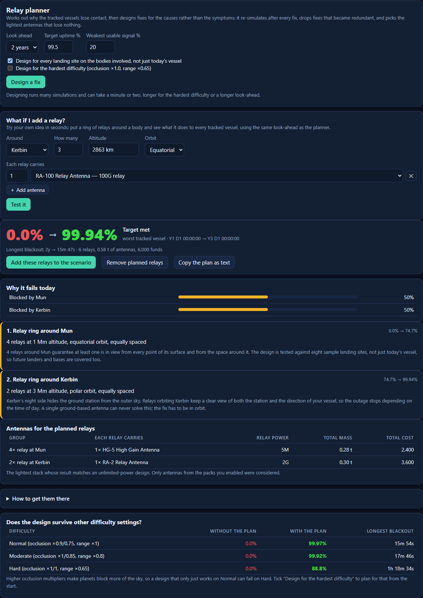
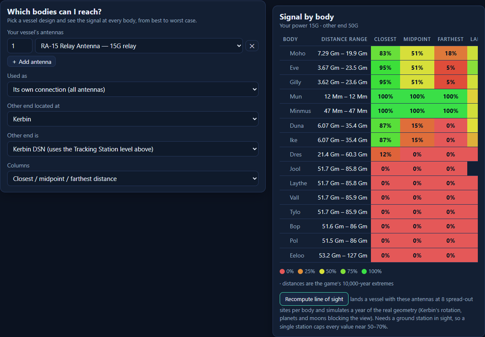
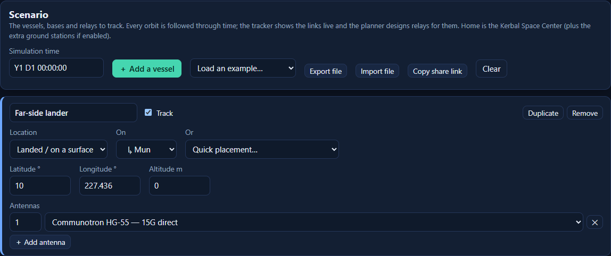

# KSP CommNet Workbench

[](https://github.com/slammingprogramming/ksp-commnet-calculator/actions/workflows/ci.yml)
[](LICENSE)

**Use it online: <https://slammingprogramming.github.io/ksp-commnet-calculator/>**

A web app for planning Kerbal Space Program's CommNet. It started as a replacement for a CommNet calculator
spreadsheet and grew into a workbench: calculate signal strength, chain relays, find antennas, **track orbits in
time, see exactly when and why a link is blocked, and design relays that fix the cause instead of the symptom**.

Built for **KSP 1.12.5** (stock, Breaking Ground, Outer Planets Mod, plus several antenna mods). No install, no
account, nothing leaves your browser.

## What it does

| Tab | Use it to |
|---|---|
| **Link & relay chain** | Build DSN → relay → relay → probe chains with range, distance and signal per hop, plus a direct-link check (the game always prefers a direct link). |
| **Antenna finder** | Enter a distance and target signal; get the minimal antenna combinations, lightest, cheapest or fewest parts first. |
| **Reach map** | See the signal at every body at its closest, midpoint and farthest distance, or across DSN levels 1–3, and optionally add a line-of-sight check that simulates a year of real geometry for a lander on each body. |
| **Scenario** | Define the vessels, bases and relays to follow: any orbit (around any body, including the Sun) or a landed position, with antennas. Import your real fleet, orbits included, from a save. |
| **Tracker** | Watch the system move: bodies, orbits, links and the spheres that block them. Play, step or jump through time, and analyze forward to list every blackout with its exact start, duration and cause. |
| **Relay planner** | Diagnose *why* a vessel loses contact, then design fixes: relay rings around the blocking body, solar relays for conjunctions. Every fix is re-simulated, redundant ones are dropped, the lightest antennas are chosen, and the result is stress-tested on every difficulty preset. |
| **Antennas & mods** | Toggle antenna packs, add your own antenna, import a mod's part `.cfg` files, or import a Kopernicus planet pack (new bodies join the distance pickers and the simulation). |

## Screenshots








## How the planner thinks

A signal is lost for a reason, and the reason decides the cure:

* **Kerbin blocks the ground station** (its night side, every day) → relays in orbit around Kerbin, or simply the
  difficulty option *Extra Groundstations*. No antenna on the ground can fix this.
* **The body you're at blocks the line** (far side, behind it in orbit) → a ring of relays around it, tested against
  eight landing sites spread over the whole surface, so future landers and bases are covered, not just today's vessel.
* **Kerbol blocks the line at conjunction** → relays in Kerbin's own orbit, 60° ahead or behind. They keep that
  position relative to Kerbin permanently, so the fix never expires.
* **Out of range or too weak** → more antenna power (sized last, so geometry is judged fairly).

After each fix the whole scenario is simulated again over the look-ahead period, the remaining outage is re-diagnosed,
and fixes made redundant by later ones are removed. You can also try your own idea (*What if I add a relay?*), leave
vessels out of the goals, and read how to get the relays on station (phasing orbit, periapsis, delta-v estimate).
Scenarios can be exported to a file or shared as a link that carries the whole scenario (nothing is uploaded).

## Using it

* **Online:** <https://slammingprogramming.github.io/ksp-commnet-calculator/> (nothing is uploaded; it all runs in your browser).
* **Offline:** download the zip from [Releases](../../releases), unzip and open `index.html`.
* **From source:** `npm start`, then open <http://localhost:8080> (Node 18+, no dependencies).

## How the maths works

```
vessel power = strongest × (Σ powers ÷ strongest) ^ e        e = power-weighted mean combinability exponent
link range   = √(power A × power B)
signal       = 3x² − 2x³   where x = 1 − distance ÷ range     (clamped to 0..1)
path signal  = product of each hop's signal
blocked      = the straight line touches a sphere of radius (body radius × occlusion modifier)
```

A vessel's own link uses all its antennas; as a relay for someone else, only its relay-type antennas count. The DSN
is 2G / 50G / 250G for Tracking Station levels 1–3. See [docs/RESEARCH.md](docs/RESEARCH.md) for sources, data
provenance and the verified antenna table.

## Accuracy and limits

* Stock and Breaking Ground antennas were read from the KSP 1.12.5 part configs; mod antennas from each mod's current
  GitHub part configs (re-checked 2026-11-21 by `scripts/check-mod-data.js`, which also runs monthly in CI). Bodies come from the KSP Wiki and the Outer Planets Mod's configs (or
  any Kopernicus planet pack you import). The maths reproduces the KSP Wiki's worked examples (see `test/`).
* The **occlusion test (including that Kerbol blocks), path choice, antenna-combining rules, link rules, ground-station
  rules and positions, and every stock body's spin phase were read from the game's own code and data files** (see
  `docs/RESEARCH.md` §2; `tools/ildump` and `tools/unityscan` are the readers). Nothing the model relies on is a guess
  any more for stock KSP; mods' own planets and stations are only as accurate as their configs.
* Orbits are two-body Kepler orbits: no perturbations, plasma blackout, Near Future reflectors or signal-strength
  multipliers. Antenna extension is not tracked: list only the antennas you deploy. Escape (hyperbolic) orbits are not imported.

## Development

```
npm test        # unit tests (Node's built-in runner)
npm start       # static dev server on :8080
npm install --no-save playwright-core && node test/smoke/smoke.js   # browser smoke test (needs Chrome; CI runs it)
node scripts/check-mod-data.js    # compare the bundled mod antennas with the mods' repositories (needs git and network)
```

`js/core.js` is the link maths, `js/orbits.js` Kepler propagation and the KSP calendar, `js/world.js` the body tree and
distances, `js/sim.js` the time-domain simulator (nodes, occlusion, paths, blackout scanner), `js/planner.js` the relay
planner, `js/data.js` antennas, bodies and stations, `js/parsers.js` part-cfg and save-file readers, and `js/app.js`
plus `js/ui-*.js` the interface. Everything is plain scripts (no build step), so the app also runs from `file://`.
`js/share.js` is scenario export/import and share-link validation. `tools/ildump` (IL disassembler) and `tools/unityscan` (Unity asset reader) are the small tools used to read the game's CommNet rules and data (see their READMEs for the legal note). Changes are listed in [CHANGELOG.md](CHANGELOG.md).
See [CONTRIBUTING.md](CONTRIBUTING.md) before opening a pull request.

To add or correct an antenna, edit the `ROWS` table in `js/data.js` (and check it against the mod's or game's own
config).

## Contact and security

* **Bugs, wrong results, ideas:** open an issue in this repository.
* **Anything private:** contact the maintainer over
  [SimpleX](https://smp14.simplex.im/a#3gZ-zeHs4QrFZKLAN0o3SC_XQJXhj1eYBVTO_c0FAtg). No account, phone number or email is needed.
* **Security or vulnerability reports:** never in a public issue. Follow [SECURITY.md](SECURITY.md): open a content-free
  issue, connect over SimpleX, verify each other with a quick signature exchange, then send the details privately.

## Support the project

KSP CommNet Workbench is free software and always will be; nothing is locked behind a donation. If it saved you time
and you would like to say thanks, you can:

* **Card / PayPal:** [ko-fi.com/scenprogramming](https://ko-fi.com/scenprogramming)
* **Crypto:**

| Coin | Address |
|---|---|
| Bitcoin (BTC), Silent Payments address (BIP 352; needs a wallet that supports it) | `sp1qq2637t6ve9zp4wh0e4ly2u7h7jwfn0k6c4535lxpp3wrqvmkua6xjqkwevyz0wwqx5ly2f0q29qh48wgf9gl0zt049za9kr9m8xgkey4cyggxa0x` |
| Ethereum (ETH) | `0x8F238db898102125Fd968ed7CaD959Cb594a7e93` |
| Monero (XMR) | `8AYK93mQEzsFFEFkuPN7wC9rPcXCyEXa1Ye5bH9U2GR3PpaZiYc84SxjMcdSdVMaaQUGmCXYkuxdDSG5bM3EVyqR25nbumV` |

Crypto transfers cannot be undone: compare the address with the one in this repository's README before sending.
The same details are in the app, on the "How it works" tab.

## Licence

Copyright (C) 2026 slammingprogramming.

This program is free software: you can redistribute it and/or modify it under the terms of the GNU Affero General
Public License as published by the Free Software Foundation, either version 3 of the License, or (at your option) any
later version. It is distributed in the hope that it will be useful, but WITHOUT ANY WARRANTY. See [LICENSE](LICENSE).

If you run a modified version as a network service you must offer its source to your users (AGPL section 13).

## Credits

* Inspired by Poodmund's *CommNet Signal Strength Calculator & Antenna Selector* spreadsheet, which showed how useful
  a CommNet calculator is. No data or formulas were copied from it: antenna values come from the games' and mods'
  own configs, and body distances are computed from the orbits.
* The KSP Wiki's CommNet page for the formulas, DSN levels and difficulty table.
* The authors of ReStock+, Near Future Exploration, CommNet Antennas Extension, DMagic Orbital Science, JX2Antenna,
  ProbesPlus and the Outer Planets Mod, whose part and planet configs were used to verify the data.

Unofficial fan project, not affiliated with or endorsed by Squad, Private Division or Take-Two Interactive.
