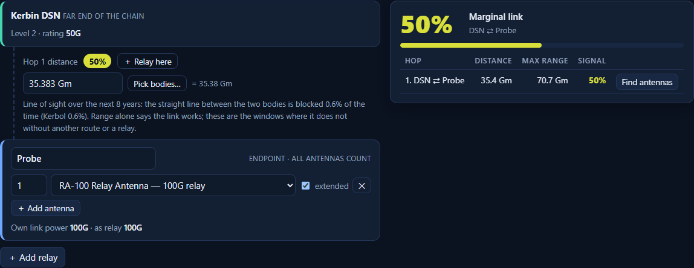
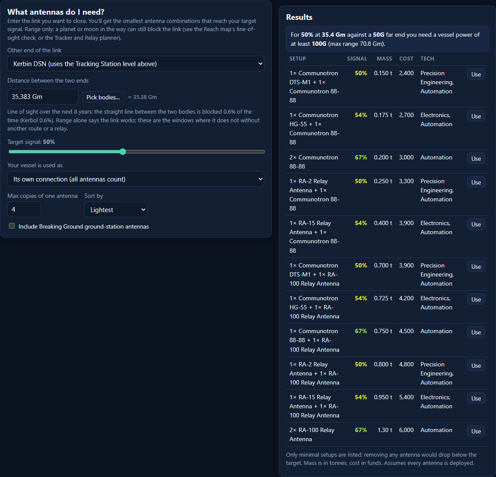
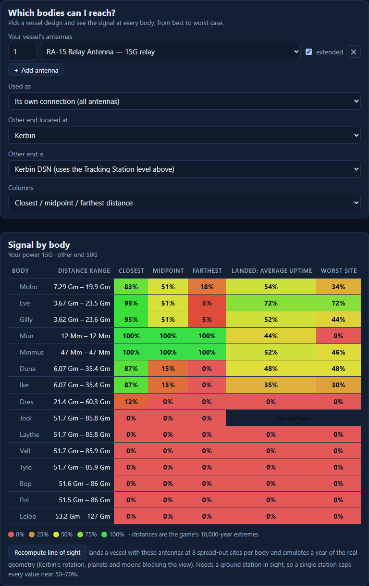

# Calculators: chain, finder and reach map

The first three tabs answer quick questions with plain range maths, no orbits or time involved. They are the
fastest way to check an antenna choice before you build it. For anything that depends on *when* (a body in the way, a
conjunction, a night side) use the [Scenario](scenario.md), [Tracker](tracker.md) and [Relay planner](planner.md) tabs.

## Link & relay chain

Build a chain from the DSN to your vessel and see the range, distance and signal of every hop.

* The **far end** is the Kerbin DSN at your Tracking Station level, a relay vessel with antennas you choose, or a custom power rating (`500k`, `2G`, `250G`).
* Give each vessel its **antennas**: a count and a part, with an *extended* checkbox (a retracted antenna does not count,
  as in the game). The card shows the vessel's **own link power** and its power **as a relay**; these differ because only
  relay-type antennas count when a vessel relays for someone else.
* Each hop has a **distance**. Type it with units (`35 Gm`, `12000 km`, `700 Mm`, `1.5e10`), or press **Pick bodies…**
  to choose two bodies and get their closest, farthest or midpoint separation, or the **actual** distance at the
  scenario's time (the *At Y1 D1 …* chip).
* **＋ Relay here** inserts a relay vessel into a hop and **＋ Add relay** extends the chain.
* The result card shows the **end-to-end signal** and a table with each hop's distance, maximum range and signal.
  Signals multiply along the path. A hop below 50% gets a **Find antennas** button.

**Direct link check.** The game connects to the DSN directly whenever a direct link exists, even when a relayed path
would be stronger. Tick *Also check a direct link from the vessel to the DSN* to see both: the app tells you which one
the game will use and what happens when the direct link is out of range.

**Line of sight.** Under a distance picker the app adds a line such as *the straight line between the two bodies is
blocked 0.6% of the time (Kerbol 0.6%)*. It tests the line between the two bodies' centres over the next 8 years with the
game's own occlusion test, so you can see whether a link that works on range alone is cut by another body, and how often.

## Antenna finder

Enter the link you want to close and get the smallest antenna combinations that reach it.

* **Other end of the link** is the same choice as the chain's far end: the Kerbin DSN, a relay vessel, or a custom power.
* **Distance** takes the same inputs as the chain, including **Pick bodies…**.
* **Target signal** is the signal you want at that distance. 50% is a common minimum for a usable link.
* **Your vessel is used as** *its own connection* (all antennas count) or *a relay* (only relay antennas count).
* **Max copies of one antenna** limits stacks, and **Sort by** orders the results lightest, cheapest, fewest parts or strongest signal first.
* Results are **minimal**: removing any antenna would drop below the target. Each row lists signal, mass, cost and the
  tech nodes you need, and **Use** puts the setup on the last vessel of the chain.

Only antennas from the packs you enabled are considered (see [Game settings and mods](settings-and-mods.md)). Breaking
Ground ground-station antennas are excluded unless you tick the box.

## Reach map

See what a vessel design can reach, everywhere in the system.

* Choose the antennas, whether they act as the vessel's own connection or as a relay, and what the other end is (a
  DSN at your level, or a vessel somewhere).
* The table shows each body's **distance range** and the signal at its **closest**, **midpoint** and **farthest**
  distance. Choose *DSN levels 1–3* in the *Columns* box to see how a Tracking Station upgrade changes things.
* **Add line-of-sight check** adds columns that simulate a year of real geometry: a vessel with these antennas is
  landed at eight spread-out sites on each body, and the table shows the average uptime and the worst site. It needs a
  ground station in sight, so a single station caps the numbers near 50–70% (Kerbin's night side). Gas giants have no
  surface and are skipped.

The distances in the first columns are the extremes the two bodies ever reach, so they are a worst and best case rather
than today's value.

Next: put real vessels on a timeline in [Scenarios](scenario.md).
