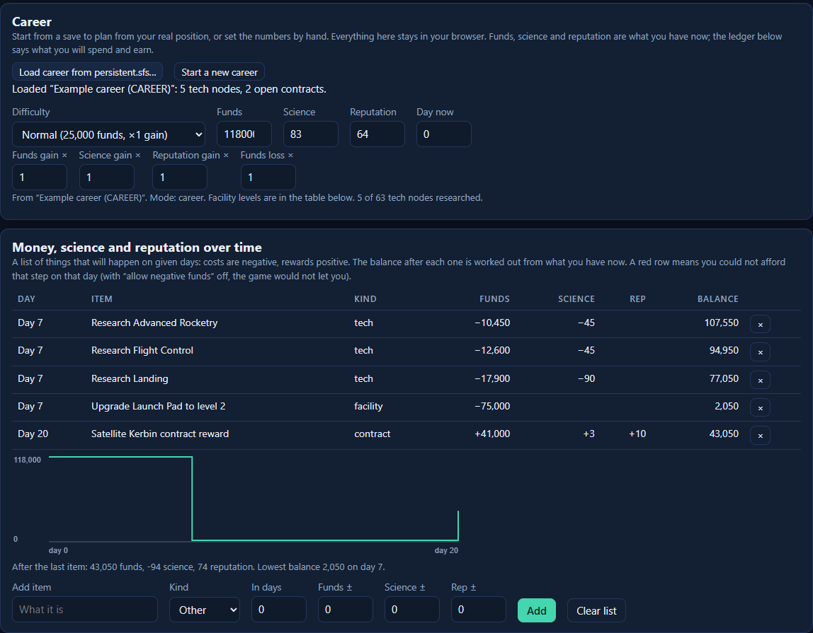

# Career: money, research and facilities

The **Career** tab is where you plan how a career save grows: what you have, what you will spend and earn, which research to
aim for, and which buildings to upgrade. The **[Missions](missions.md)** tab feeds it with the cost and reward of each flight.

## Where you stand

Press **Load career from persistent.sfs…** (KSP/saves/&lt;save&gt;/persistent.sfs) to read your funds, science and reputation, the
difficulty multipliers, the researched tech nodes and parts you bought, the level of every facility, and the contracts you
hold or are offered. The file never leaves your browser. Or press **Start a new career** and pick a difficulty preset, then
type the numbers in by hand: you can also edit anything after loading a save.

| Preset | Starting funds | Funds, science, reputation gain | Funds and reputation loss |
|---|---|---|---|
| Easy | 250,000 | ×2 | ×0.5 |
| Normal | 25,000 | ×1 | ×1 |
| Moderate | 15,000 | ×0.9 | ×1.5 |
| Hard | 10,000 | ×0.6 | ×2 |

A sandbox save has every building at level 3 and every part unlocked, so the planner treats it as having nothing to plan
besides the missions themselves.

## Money, science and reputation over time

The core of the tab is a list of things that will happen on given days: launches (negative), recoveries and contract
rewards (positive), facility upgrades, research (it costs science and the funds for the new parts). The app orders them by day
and works out the balance after each one, the lowest point, and the first day you could not afford a step (a red row, and a
warning). A small chart shows the funds balance as steps.

Items arrive from the other cards: **Plan** next to a facility upgrade, **Add the plan to the money list** under the tech
plan, **Plan reward** next to a contract, and **Add to the money list** on a mission. Or type your own.

## Facility upgrades

Every facility with its level, what that level allows, what the next level allows, and the price of the next step. All of it
comes from the game itself (see [RESEARCH.md](RESEARCH.md), section 8):

| Facility | Level 1 → 2 | Level 2 → 3 | What the levels change |
|---|---|---|---|
| Launch Pad, Runway, Mission Control, Astronaut Complex | 75,000 | 282,000 | Pad: launch mass 18 t, 140 t, unlimited. Mission Control: 2, 7 or unlimited active contracts, flight planning from level 2. Astronaut Complex: 5, 12 or unlimited active kerbals |
| Tracking Station, Administration | 150,000 | 563,000 | Tracking: tracked objects none/8/unlimited, conic patches shown none/2/all, the maneuver tool at level 3. Administration: 1, 3 or 5 strategies and a commitment of up to 25%, 60% or 100% |
| Vehicle Assembly Building, Spaceplane Hangar | 225,000 | 845,000 | parts per vessel 30, 255, unlimited |
| Research & Development | 451,000 | 1,690,000 | nodes up to 100, 500, unlimited science; data-to-science ratio 40%, 80%, 100% |

The first launch pad price in the game files differs between two copies of its data (75,000 in the space-centre scene, 50,000 in
a shared prefab); the app uses the scene value, which also fits the pattern of the other buildings.

## Tech tree plan

Pick the nodes you are working towards. The plan lists every missing prerequisite in a research order (a node that needs only
one of several parents takes the cheaper route), the science each costs, a running total, the number of new parts and what
buying them costs. A node that costs more science than your Research & Development level allows is marked. Below it, the nodes you
could research right now.

Parts are priced two ways in the game: the node costs **science**, and each new part then costs its **entry cost** in
funds. The plan shows both.

## Science worth at a body

For any body, every experiment in every situation (landed, splashed, flying low or high, in space low or high): the body
multiplier, the science for the first return and the cap of that subject, and what it gives if transmitted instead of
recovered (the experiment's transmit efficiency). Each **biome** is its own subject, so repeating an experiment in a new biome pays again; the Landing tab shows the biomes of each body and which experiments are per biome ([Landing](landing.md)).

## Contracts

The contracts in the save, with advance, reward, penalty, science and reputation. Rewards can be planned onto the money
list. The Mission Control level sets how many you can hold at once.

## Milestones ("World First")

The first time you reach a milestone the game pays a reward: reaching orbit, flying by, landing, escaping, planting a flag, walking
on the surface, a spacewalk, returning from orbit or from the surface, rendezvous, docking, transferring crew, building a base or a
station, and the one-offs (first launch, reaching space, recovering a crew, tower buzz). Each is paid once per body.

The list gives the funds, science and reputation of each, with your difficulty gain and your active strategies in it, and marks the
ones your save already has (when you load `persistent.sfs`). **Plan reward** puts one on the money list. The formula is the
game's (see [RESEARCH.md](RESEARCH.md), section 8):

reward = base × 0.2 × score of the milestone (at the home planet or elsewhere) × 1.5 for the outliers × the tier factor (1, 1.25 or 1.5) × your gain,
and for funds on a body also × (1 + (the body's recovery value − 1) × 0.3), rounded.

The base is 80,000 funds, 8 science and 16 reputation. A landing is worth 0.1 at Kerbin and 1.5 anywhere else, which is why the far
worlds pay much more. The altitude, speed, distance and depth **records** pay by interval and are not in the list.

## Strategies

The Administration Building lets you run strategies that convert one kind of income into another. The card lists all eleven with the
department, what each does, the commitment you can set (up to 25%, 60% or 100% by the building's level), the starting price at that
commitment, and whether your reputation allows it. Turn one on and set the commitment: the milestone list and the sentence under the
table show what your strategies do to income (for example Leadership Initiative at full commitment multiplies milestone funds and
reputation by 2.5 and cuts contract income to a quarter; Fundraising turns a share of reputation gains into funds).

The conversion rates, prices and limits are the game's. The way several effects stack, and the effect on contract rewards in play,
were read from the game's code and not compared with a played save. Strategies are applied to milestone rewards and to the examples
under the table; they are not yet applied to the contract rewards or the recoveries on the money list.

## What it does not do
* Contract rewards you estimate on the Missions tab are base values times the difficulty gain: the real offers vary with
  the body and your progress, so type in the figure from the contract card when you have it.
* **Hiring Kerbals** shows the price of the next hires from the number on the roster (the game's formula, read from its code); salaries, funds from selling science, and part failures are not modelled.
* **Records** (altitude, speed, distance, depth) pay in five steps; the milestone card lists the thresholds and rewards and marks the steps your loaded save has passed. Active strategies apply to launches, recoveries and contract money as the game applies them.
