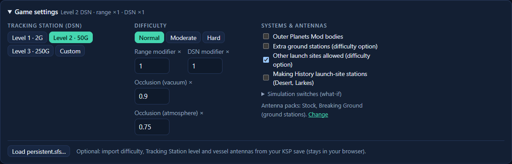
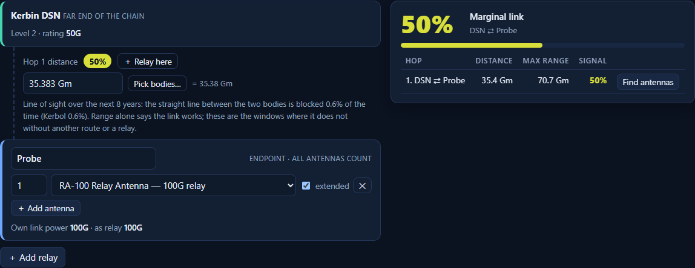
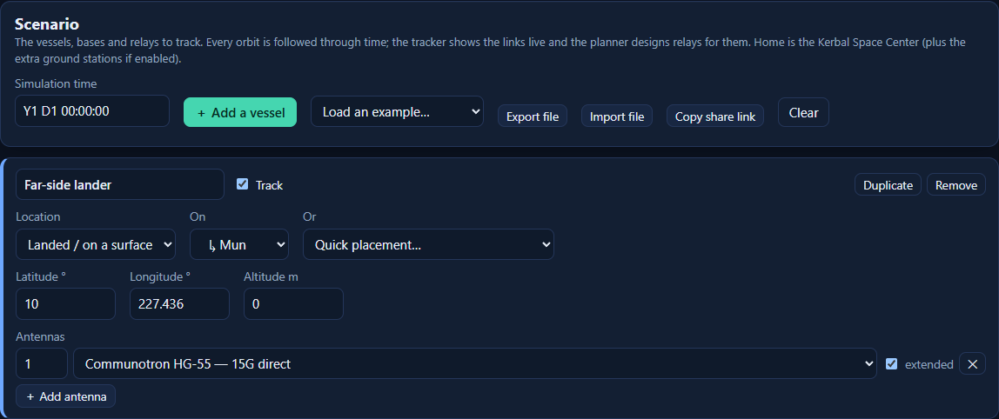
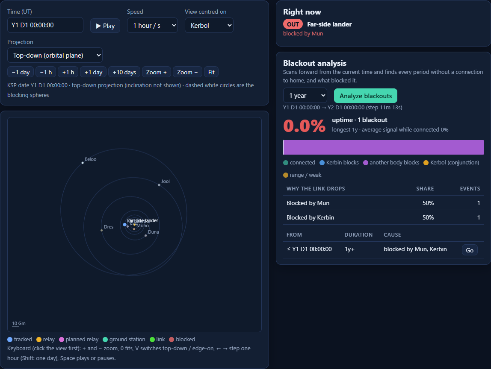
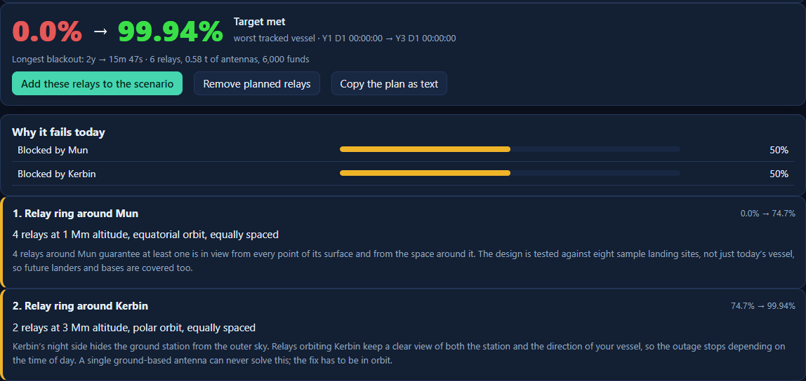

# Getting started

Ten minutes from opening the app to a relay plan you can fly. This walks through one example, a lander on the far side
of the Mun that never sees Kerbin.

## Open it

* **Online:** <https://slammingprogramming.github.io/ksp-commnet-calculator/>. Nothing is uploaded; it all runs in your
  browser.
* **Offline:** download the zip from [Releases](https://github.com/slammingprogramming/ksp-commnet-calculator/releases),
  unzip, and open `index.html`.
* **From source:** `npm start`, then open <http://localhost:8080> (see [Development](development.md)).

Everything you enter is kept in your browser's local storage, so a reload picks up where you left off. The **Reset**
button at the top right clears it.

## 1. Tell it about your game

Open **Game settings** at the top and set what your save uses:

* **Tracking Station level** sets the DSN rating (2G, 50G or 250G).
* **Difficulty** presets fill in the range, DSN and occlusion modifiers; edit any of them for a custom setup.
* Tick **Extra ground stations** if your save has *Enable Extra Groundstations* on.
* Tick **Outer Planets Mod bodies** if you play with OPM, and use **Change** under *Antenna packs* to add mod antennas.

The fastest way is **Load persistent.sfs…**: pick your save file and the app copies your difficulty and Tracking Station
level, and later lets you import your real vessels. The file is read in your browser and never uploaded. Details:
[Game settings and mods](settings-and-mods.md).

## 2. Quick checks, no orbits needed

The first three tabs are calculators. Try the **Link & relay chain**: it starts as a DSN and a probe, shows the distance
and the signal strength, and lets you add relays between them.

If a hop is weak, **Find antennas** opens the **Antenna finder** with that distance filled in, and **Use** puts the
chosen setup back on your vessel. The **Reach map** shows the signal at every body for a given vessel design. See
[Calculators](calculators.md).

## 3. Put your vessels in a scenario

The **Scenario** tab is the list of things to follow through time: orbiters, landers, bases and relays. Choose
**Load an example… → Far-side Mun lander**, or add a vessel yourself, or import your fleet from a save.

See [Scenarios](scenario.md).

## 4. See when and why it loses contact

Open the **Tracker** and press **Analyze blackouts**. It scans the next year and lists every period without a
connection, with its start, duration and cause.

The far-side lander is blocked by the Mun for the whole year, and by Kerbin's own night side as well. See [Tracker](tracker.md).

## 5. Let the planner design the fix

Open the **Relay planner** and press **Design a fix**. It works out the cause of each outage, designs a fix for it,
re-simulates, removes anything redundant, picks the lightest antennas and stress-tests the result.

**Add these relays to the scenario** puts the planned relays on the Tracker (in magenta) so you can watch them work, and
**Copy the plan as text** gives you something to paste into your notes. See [Relay planner](planner.md).

## Where to go next

* [Calculators](calculators.md): the chain, the finder and the reach map.
* [Scenarios](scenario.md): vessels, saves, patched conics, export and share links.
* [Tracker](tracker.md) and [Relay planner](planner.md).
* [Game settings and mods](settings-and-mods.md): difficulty, packs, mod antennas, planet packs.
* [How the model works](model.md) and [FAQ](faq.md).
