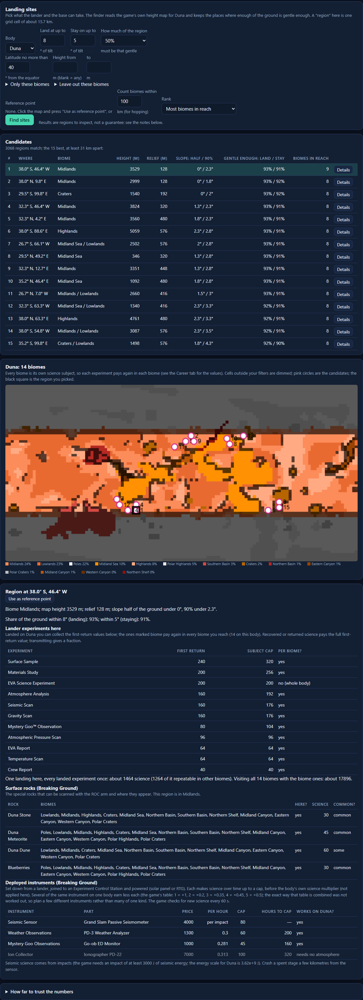

# Landing: where to put down, and what to do there

The **Landing** tab finds places to land by how much tilt you can take, shows the biomes of a body, and lists what a lander can
measure at the spot you pick, including the Breaking Ground instruments and surface rocks. It reads the game's own height and
biome maps, so it works the same on stock bodies as the game does.

## Find sites

Pick a body, then say what you can live with. Press **Find sites** and the best places come back as a table and as pink numbered
circles on the map. Cells that fail your limits are dimmed.

| Setting | What it does |
|---|---|
| **Land at up to … ° of tilt** | the steepest ground you can touch down on |
| **Stay on up to … ° of tilt** | the steepest ground you can stay parked on (a base, a rover, a deployed station); normally gentler than the landing limit |
| **How much of the region must be that gentle** | a region is one cell of the map (see the size in the text above the form); this is the share of its ground that has to be within both limits: 25%, 50%, 75% or 90% |
| **Latitude, height** | keep to an equatorial band (sun, communications, getting back up) or a height range, in metres on the map |
| **Only these biomes / Leave out these biomes** | each biome is its own science subject, so you can aim for the ones you still need or skip a hard one |
| **Reference point** | click the map and press "Use as reference point" (or the Space Center on Kerbin), then limit the search to a distance from it |
| **Count biomes within … km** | how many different biomes are within hopping range of the site; useful for a rover or a hopper |
| **Rank** | flattest first, most biomes in reach, closest to the reference point, lowest or highest ground |
| **Dry land only** | on Kerbin, Eve and Laythe, leave out the ground under the sea |

Click the map or press **Details** on a row to see the region: its biome and the one next to it, the map height, the relief, the
slope (half of the ground is under one value, nine tenths under another) and how much of it passes your two limits.

## What a lander can measure there

For the picked region the tab lists every experiment that works landed, with the first-return value and the cap for the subject. The
ones marked "per biome" pay again in every biome you reach, and the tab adds up one landing and a trip through all the biomes of the
body. Recovering the science pays the first-return value; transmitting gives a fraction (see [Career](career.md#science-worth-at-a-body)).

### Breaking Ground (DLC)

If you own the expansion the same panel shows two more things:

* **Surface rocks**: the special rocks you can scan with the ROC arm, the biomes each appears in, whether the region you picked is
  one of them, how much science the scan can give and how common the rock is.
* **Deployed instruments**: the four sensors you set down from a lander (a seismometer, a weather analyser, a goo monitor and an
  ion collector), with the part price, the science per hour, the cap, how many hours that takes and whether the instrument works
  on this body (the weather analyser needs an atmosphere, the ion collector a vacuum). The experiment control station and the power
  parts are needed too; the panel lists the instruments, not the full kit.

The game scales the yield by a table when you put several of the same instrument on a body (the tab shows it), but the way it
combines that table with the cap was not worked out, so the tab does not predict the total for a field of identical sensors. The base and cap
values are before the body's own science multiplier, which the tab does not apply.

## How far to trust the numbers

The map data are what the game's terrain generator starts from. The generator then adds noise (hills, craters, rocks) that is not
in the maps, so:

* **Slopes are regional.** One map pixel is hundreds of metres to a kilometre. A region that passes is a good place to *look*; the
  ground right under the lander can still be steeper. A region that fails is steep.
* The height map has 256 levels, so heights change in steps of a few tens of metres; gentle slopes below a degree or two are not
  resolved, and a "flat" region can hide them.
* **Minmus, Ike, Gilly, Bop and Pol have no height map** (their ground is made by noise alone). The tab shows biomes for them but no
  slope; all the slope filters pass.
* Heights are the map's heights. The true surface also depends on the noise and on a few fixed offsets, so expect an error of
  a few hundred metres.
* The Space Center's own biomes and the special sites (anomalies, launch sites) are not in the maps and are not shown.

A good routine: use the finder to get a shortlist, check the map view of the game near each candidate, then pick by what you see
when you get there.

## Where the data comes from

`python tools/unityscan/unityscan.py "<KSP folder>" facts.json --terrain=<folder>` reads the height map and the biome map of every body
from the game's asset file (the map for a body is found by walking the game's object hierarchy to the body it belongs to, and the
orientation was checked against the Kerbin ground stations: all land on the right biomes). `node scripts/build-terrain-data.js <folder>`
turns them into `js/terrain-data.js`: a 128 × 64 grid per body with the main and second biome, the mean height, the relief and the 25th,
50th and 90th percentile of the slope computed on the full-size map. Numbers only, no pictures. See [Development](development.md).
