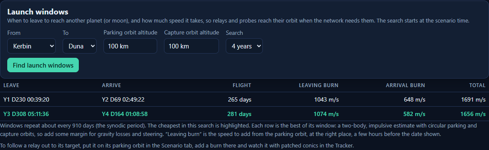

# Launch windows and manoeuvres

Relays only help when they arrive on time. The **Launch windows** tab finds when to leave for another planet or moon and
roughly how much speed it costs, and the Scenario tab lets you put the resulting burn on a vessel and watch where it goes.

## Find launch windows

Choose a **From** body and a **To** body that orbit the same parent (planet to planet around Kerbol, or moon to moon
around a planet), the parking orbit altitude, the capture orbit altitude (leave it blank for a fly-by), and how far to
search. Press **Find launch windows**.

Each row is the best transfer of one window:

| Column | Meaning |
|---|---|
| Leave, Arrive, Flight | the departure date, the arrival date and the time in between |
| Leaving burn | the speed to add from the circular parking orbit, a few hours before the date shown |
| Arrival burn | the speed to shed to be captured into the circular capture orbit |
| Total | the sum; the cheapest in the search is highlighted |

Windows repeat every synodic period. The search solves Lambert's problem for a grid of departure dates and flight times
between the real positions of the two bodies, so it follows their actual orbits, not just the textbook Hohmann geometry.

**It is an estimate:** two-body, impulsive burns, circular parking and capture orbits. Add a margin for gravity losses and
steering.

## Encounter burn

For a moon of the body you orbit, the **Encounter burn** card finds the single burn from a circular parking orbit that reaches the moon: when to light it, the prograde, normal and radial components (the manoeuvre node axes), the flight time, the arrival speed and the capture burn. It joins your orbit to the moon's centre at arrival with a Lambert arc, so trim the periapsis afterwards. Enter it as a burn on the Scenario tab and the Tracker draws the patched conic to the encounter.

## Putting a burn on a vessel

On the **Scenario** tab, an orbiting vessel has **Manoeuvres**: add a burn with a time and prograde, normal and radial
speed changes (m/s). Prograde is along the velocity, normal out of the orbital plane, radial away from the body. After the
last burn the vessel follows its [patched conics](scenario.md#escape-trajectories-and-patched-conics), so a transfer, an
escape or a capture shows up in the [Tracker](tracker.md) and in every link calculation, including the planner and the
network tab.

A useful routine: put a relay on its parking orbit, add the leaving burn from the table at the date shown, and watch it
cross to the target in the tracker. Fine-tune the burn until the encounter happens, then use the network and planner tabs
to check the link during the cruise and after arrival.

Burns are impulsive unless you give one a duration in seconds (then it is flown as short pulses); there is no staging or fuel model; the total delta-v is shown so you can compare it with your
rocket's budget. A scenario can carry up to 12 burns per vessel, and they travel with export files and share links.
