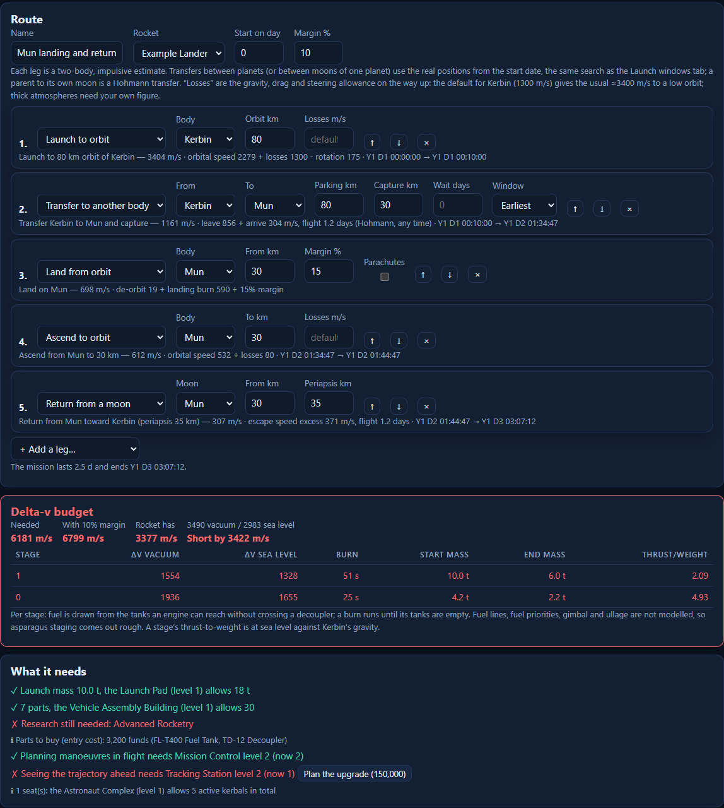

# Missions: rockets, delta-v and cost

The **Missions** tab turns a rocket and a route into a verdict: can this rocket do this mission, what must be researched and
upgraded first, and what does it do to your funds. It works on its own and, with the [Career](career.md) tab, from the state of
your save.

## Rockets

Press **Import .craft files…** and pick files from KSP/saves/&lt;save&gt;/Ships/VAB or SPH. For each one the app reads every
part, adds up the price and mass, and works out the delta-v **stage by stage** from your staging:

* Price: each part's own price plus the propellant in its tanks, exactly as the game adds it up. On the rockets this was checked against (28 of
  them), 22 match the game's own saved totals to the unit; the other six had stale saved totals or a renamed old part.
* Mass: part masses plus propellant. The game takes the crew mass out of a command pod's part mass (0.094 t per seat), so does the app.
* Delta-v: stages fire from the highest stage number down. A decoupler lets go of whatever hangs on its explosive node (or, for a
  radial decoupler, itself and what hangs on it). An engine burns the propellant it can reach without crossing a decoupler.
  A burn is cut into phases at every tank that runs dry, so boosters that burn out while a core stage keeps going are handled.
  You get the figure in vacuum and at sea level (the engine's two Isp values); the first stage is counted between them.
* Recoverable value: the parts that never separate, with their remaining propellant.

Fuel ducts are followed: a duct hangs on one part and feeds the part at its far end, so boosters that feed the core through ducts
drain first and the core is full when they drop (asparagus staging). Tanks drain in order of the stage they separate in (the
game's rule, with the part's own priority setting added), tanks of the same rank share equally, and solid fuel stays in its own part.
Engines with several modes (R.A.P.I.E.R., Panther) burn their closed-cycle (or first) mode in the columns; the tooltip of the sea-level column gives the delta-v of the air-breathing mode on the same fuel.
Not modelled: fuel flow rules you set by hand beyond the priority number, gimbal, ullage, and drag and gravity losses inside the rocket's own delta-v
(they are in the route's allowance instead). Parts from mods are known after you pick their part files with **Import mod parts (.cfg)**: tanks, engines and decouplers
get a price, a mass and a delta-v (they count as available in a career; Module Manager patches are not applied).

## Routes

A mission is a list of legs, each with its own delta-v. Start from a template (orbit, Mun or Minmus landing and return, Duna
orbiter, Duna landing and return) and change it.

| Leg | What it uses |
|---|---|
| Launch to orbit | orbital speed + a loss allowance − the rotation bonus. 1,300 m/s for Kerbin gives the usual ≈3,400 m/s to a low orbit; airless bodies take 15% of the orbital speed; thick atmospheres, and any leg where you fill in *thrust-to-weight*, simulate a gravity turn with the body's air (a point mass at that thrust-to-weight with the pitch kick searched: a guide, not the game's flight model); a figure typed into *Losses* always wins |
| Transfer | planet to planet (or moon to moon; or a moon of one planet to another planet or moon, using the planets' window and pricing the moon ends as an escape or a capture, with the moon assumed on the right side): the same Lambert search as the [Launch windows](launch-windows.md) tab from the mission start date, earliest or cheapest window, with real dates. A planet to its own moon: a Hohmann transfer. Capture can be skipped for a fly-by |
| Land from orbit | de-orbit burn + the speed at the surface, plus a margin; with parachutes on a body with air, a small powered allowance |
| Ascend to orbit | orbital speed + losses |
| Return from a moon | the escape that drops to a chosen periapsis at the parent planet |
| Plane change, other burn | the usual formula, or your own number |

Everything is a two-body, impulsive estimate from circular orbits; the margin box adds a percentage on top.

## The verdict

* **Delta-v budget:** needed, needed with the margin, and what the rocket has, with the per-stage table (thrust-to-weight at
  Kerbin sea level) and "short by" or "to spare".
* **What it needs:** the launch mass against the Launch Pad, the part count against the Vehicle Assembly Building or Spaceplane
  Hangar, research still missing and the entry price of parts you have not bought, and the Mission Control and Tracking Station
  levels for planning manoeuvres. A failing facility check has a button that puts the upgrade on the money list.
* **What it does to the money:** the rocket's price out, recovery in (100% on the pad or runway, 98% elsewhere at the space centre,
  between 98% and 10% by distance from it), and contracts you attach. Estimates for a contract type use the base values from
  the game's settings times the difficulty gain; or copy one from your save. **Add to the money list** books the lot on
  the days of the mission.

The rule for recovery and the facility limits come from the game's code, see [RESEARCH.md](RESEARCH.md), section 8.

## Using it with the other tabs

* Put the route's transfer into the [Scenario](scenario.md) tab as a burn to watch it in the [Tracker](tracker.md).
* A relay mission needs the [Relay planner](planner.md) to say where the relays go; this tab says whether the rocket can carry them there.
