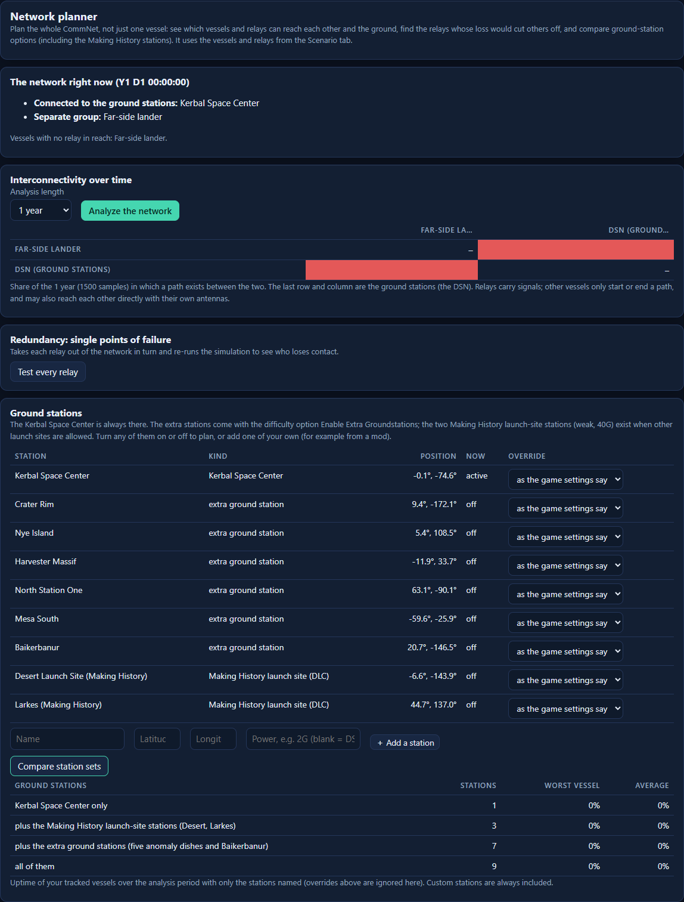

# Network planner

The **Network** tab looks at the whole CommNet instead of one vessel: who can talk to whom, which relays everything
depends on, and what the ground stations contribute. It uses the vessels and relays you put on the
[Scenario](scenario.md) tab, so build the network there first.

## The network right now

The first card shows the state at the scenario time:

* **Connected to the ground stations** lists every vessel that has a path to the DSN.
* **Separate groups** are vessels that reach each other but not the ground, for example a lander and an orbiter whose only
  link home is blocked.
* **Vessels with no relay in reach** have nobody to pass their signal on.

## Interconnectivity over time

Choose an analysis length and press **Analyze the network**. The matrix shows, for every pair of vessels and for the
ground stations (the DSN), the share of the period in which a signal path exists between the two.

* Only **relays** carry signals for others: an antenna that is marked as a relay and has range. A vessel with no relay
  antenna only starts or ends a path. Two such vessels can still reach each other directly with their own antennas.
* All ground stations count as one network, the DSN.
* The paths follow the game's rules: the best product of link strengths, with line of sight checked at every step
  ([How the model works](model.md)).

## Redundancy: single points of failure

**Test every relay** takes each relay out of the network in turn and runs the simulation again. The table lists, for each
relay, how much uptime every vessel keeps without it. A relay whose loss drops somebody to zero is a **single point of
failure**; a second relay on a different orbit is the usual cure, and the [Relay planner](planner.md) can design it.

## Ground stations, including the Making History ones

The table lists every ground station the game can have, with its position and whether it is active at the moment:

| Station | When it exists in the game |
|---|---|
| Kerbal Space Center | always |
| Five anomaly stations and Baikerbanur | only with the difficulty option *Enable Extra Groundstations* |
| Desert Launch Site and Larkes (Making History) | when other launch sites are allowed; they are weak (40G) fixed antennas |

Each row has an **override**: force a station on or off to try a different network without changing the game settings.
**Add a station** adds your own (name, latitude, longitude and optionally a power such as `2G`; blank uses the DSN
level), for example a base from a mod.

**Compare station sets** simulates four set-ups side by side (the Kerbal Space Center only, plus the Making History
stations, plus the extra stations, and all of them) and shows how the worst and the average vessel fare in each. It is
the quick way to see whether a launch-site station is worth building a base for. Station overrides are ignored in the
comparison; custom stations are always included.

## Tips

* Put the relays you already have in the scenario, then add a candidate relay and compare the matrix before and after.
* A vessel that shows as "separate group" is usually missing one relay on the far side of a body. The
  [Tracker](tracker.md) shows which body blocks it and when.
* Everything on this tab uses the difficulty settings (range modifier, DSN level and modifier, occlusion modifiers) from
  the game settings panel.
