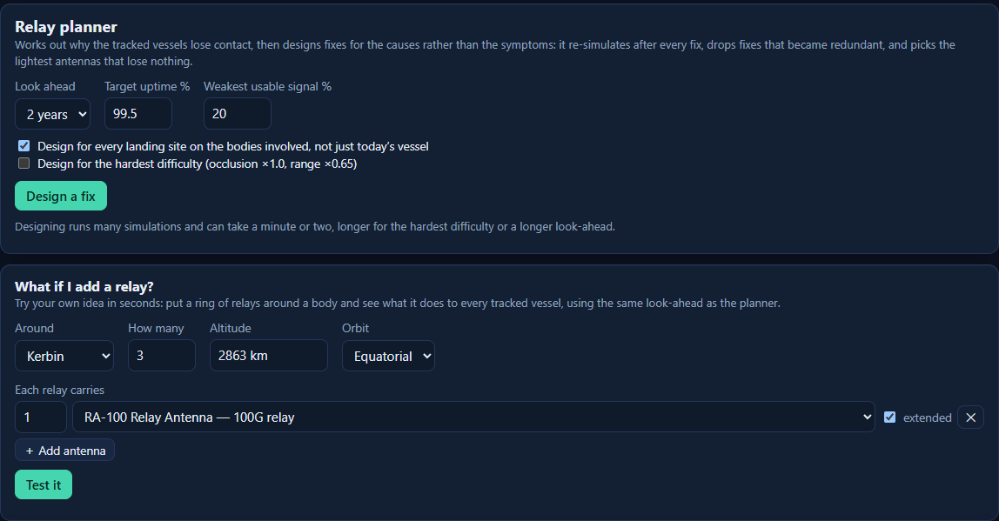
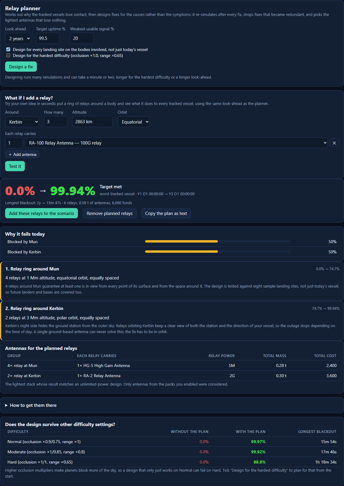
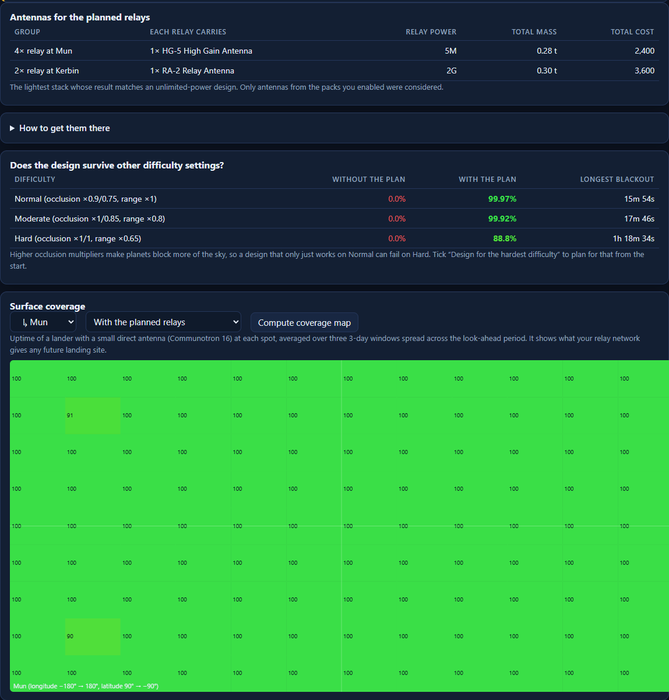

# Relay planner

Diagnoses *why* your tracked vessels lose contact, then designs fixes for the causes rather than for the symptoms,
and checks them. It works on the vessels in your [Scenario](scenario.md).

## Run it

1. Set the **look-ahead** (1 to 8 years), the **target uptime** (default 99.5%) and the **weakest usable signal** (a
   connection below it counts as a blackout).
2. Tick **Design for every landing site on the bodies involved** to cover future landers and bases and not just today's
   vessel. Tick **Design for the hardest difficulty** to plan for Hard from the start.
3. Optionally untick vessels under **Plan for these vessels**: they still relay, but need no fix.
4. Press **Design a fix**. It runs entirely in your browser and takes from about twenty seconds to a couple of minutes;
   the page stays responsive and you can cancel.

## How it thinks

A signal is lost for a reason, and the reason decides the cure:

* **Kerbin blocks the ground station** (its night side, every day) → relays in orbit around Kerbin, or the difficulty
  option *Extra Groundstations*. No antenna on the ground can fix this.
* **The body you are at blocks the line** (far side, behind it in orbit) → a ring of relays around it, tested against
  eight landing sites spread over the whole surface, so future landers and bases are covered too.
* **Kerbol blocks the line at conjunction** → relays in Kerbin's own orbit, 60° ahead or behind. They keep that
  position relative to Kerbin permanently, so the fix never expires.
* **Out of range or too weak** → more antenna power, sized last so the geometry is judged fairly first.

After each fix the whole scenario is simulated again over the look-ahead period, the remaining outage is re-diagnosed,
and fixes made redundant by later ones are removed. A fix is accepted only if uptime actually improves, and causes
that had no fix are retried after another fix lands.

## Reading the result

* The headline is the **uptime of the worst tracked vessel before and after**, the longest blackout, and the total
  number of relays, antenna mass and cost.
* **Why it fails today** shares the downtime among the blocking bodies.
* Each fix card gives the design (for example *4 relays at 1 Mm altitude, equatorial orbit, equally spaced*), its effect on
  uptime and why it works.
* **Add these relays to the scenario** puts the planned relays into the Scenario and Tracker (in magenta).
  **Remove planned relays** takes them out again, and **Copy the plan as text** gives something to paste into notes.

* **Antennas for the planned relays** lists the lightest stack that matches an unlimited-power design, using only the
  packs you enabled.
* **How to get them there** gives a phasing orbit for putting several equally spaced relays on one ring from one
  carrier: the number of laps, the period, the periapsis (kept above the minimum altitude) and a delta-v estimate. These
  are two-body estimates without gravity losses.
* A **callout** says when the difficulty option *Enable Extra Groundstations* alone would give you a similar uptime with
  nothing launched.
* **Does the design survive other difficulty settings?** re-runs the scenario with and without the plan on Normal,
  Moderate and Hard. Higher occlusion multipliers make planets block more of the sky, so a design that only just works on
  Normal can fail on Hard.
* **Surface coverage** maps the uptime of a lander with a small direct antenna (a Communotron 16) across a body's surface,
  with or without the planned relays, averaged over three 3-day windows.

## What if I add a relay?

Try your own idea in seconds. Choose a body, a number of relays, an altitude, an equatorial or polar orbit and the antennas
each carries, and press **Test it**: the app puts the ring in and shows what it does to every tracked vessel, with the
same look-ahead as the planner.

## Budget and targets

Under the options you can set a **budget**: most relays, most antenna mass (tonnes) and most cost (funds). The planner
designs as usual, then drops the fix that matters least, one group at a time, until the design fits, and the result
shows what the budget cost you in uptime. A vessel can also get its **own uptime target** (next to its name under
*Plan for these vessels*); the result lists whether each target is met.

**Reuse of what you have:** every relay already in the scenario counts as part of the network, so the planner only adds
what is missing. Put your existing relays in the Scenario tab first.

## Coverage map resolution

The surface coverage map has a **resolution** choice: coarse (30° × 45° cells, two 3-day windows), normal (20° × 30°,
three windows) or fine (10° × 15°, four windows). Finer maps take proportionally longer.

## Limits

* The search is a heuristic: it finds good designs and verifies them by simulation, but they are not provably optimal.
* Candidate shapes are circular equally spaced rings (equatorial or polar), keostationary rings for Kerbin, elliptical
  rings (a low periapsis and a high apoapsis) and solar relays 60° from Kerbin. It does not design arbitrary
  constellations.
* Everything is judged with the two-body model described in [How the model works](model.md): no manoeuvres, no
  perturbations (the game has none).
