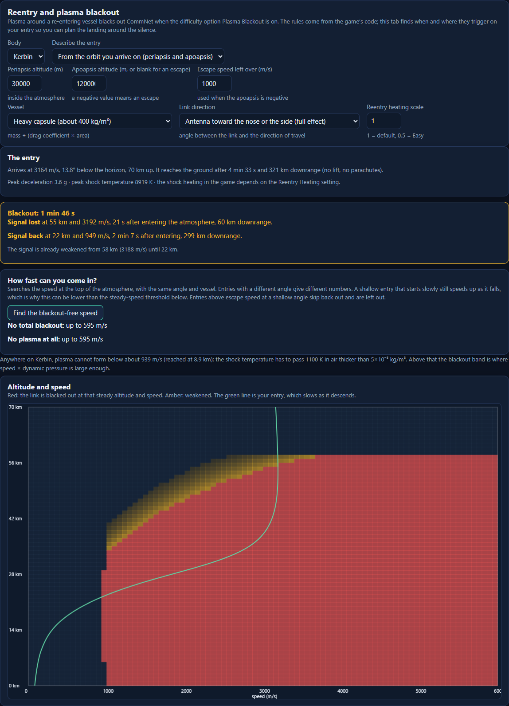

# Reentry and plasma blackout

With the difficulty option **Plasma Blackout** on, the plasma around a re-entering vessel cuts its CommNet link. The
**Reentry** tab works out when and where that happens for an entry you describe, how fast you can come in without losing
contact, and shows the blackout on a map of altitude against speed, so you can plan the landing around the silence.

## Describe the entry

Pick the **body** (Kerbin, Eve, Duna, Jool or Laythe: the stock bodies with an atmosphere) and how the entry is described:

* **From the orbit you arrive on** (periapsis and apoapsis altitude, or a leftover escape speed for an incoming hyperbola).
  The app works out the speed and angle where the orbit reaches the top of the atmosphere. This is the most reliable
  input.
* **By speed and angle** at the top of the atmosphere.

Then choose the **vessel** (its ballistic coefficient: mass divided by drag coefficient times area; presets from a light
probe to a heavy capsule), the **link direction** (the antenna's angle to the direction of travel decides how much of the
plasma it sees) and the **reentry heating scale** (the game's difficulty setting: 1 is the default, 0.5 is Easy).

## What you get

* The entry: speed and angle at the top of the atmosphere, time to the ground, downrange distance, peak deceleration and
  peak shock temperature.
* **Blackout:** how long it lasts, **where the signal is lost** (altitude, speed, time after entering, downrange) and
  **where it comes back**, plus the stretch where the signal is only weakened.
* **How fast can you come in?** Press **Find the blackout-free speed** to search for the highest entry speed at the top of
  the atmosphere, for the same angle and vessel, that gives no total blackout, and the highest with no plasma at all.
  A shallow entry that begins slowly still speeds up as it falls; entries above escape speed at a shallow angle skip back
  out of the atmosphere and are left out.
* Below the cards, the slowest speed at which plasma can form on that body at all.
* A map of altitude against speed: red where the link is blacked out at that steady altitude and speed, amber where it
  is weakened, and your entry as a line through it. Real entries slow down as they descend, which is why the line bends
  left.

## The rules behind it

They come from the game's own code and data (CommNetVessel's plasma calculation, the `Physics.cfg` thresholds and the
atmosphere curves read from the planet prefabs), described in [RESEARCH.md](RESEARCH.md):

* The **shock temperature** is the speed (below Mach 2) blended into 21 × speed^0.75 (above Mach 5), times the body's own
  shock multiplier and the reentry heating scale. The air temperature counts if it is higher.
* Plasma forms only when that temperature is above **1100 K**, the air is denser than **5×10⁻⁵ kg/m³** and dynamic
  pressure × speed is above 500. Its strength rises to full at 2500.
* Each link is weakened according to the angle between the link and the direction of travel: a link that points
  forward or to the side sees the full plasma, one that points straight back sees none. The signal is multiplied by a
  factor that is zero once the plasma term passes 0.5, so a link that does not point behind the vessel is lost
  completely when pressure × speed passes about 1500.

## Limits

* The descent is a **point mass with a constant ballistic coefficient**: no lift, no parachutes, no tumbling, no
  change in drag as the vessel slows. It is a planning estimate, good for "when do I lose signal and roughly where", not
  a flight simulator.
* The sun and latitude temperature bias the game adds to the air temperature is not modelled.
* Only a vessel in an atmosphere is affected: plasma never matters for orbiting or landed vessels, which is why the other
  tabs ignore it.
