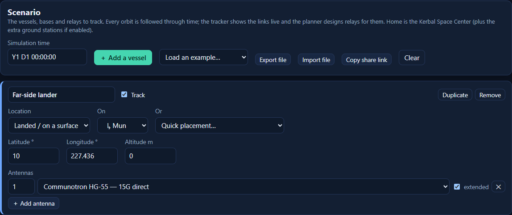
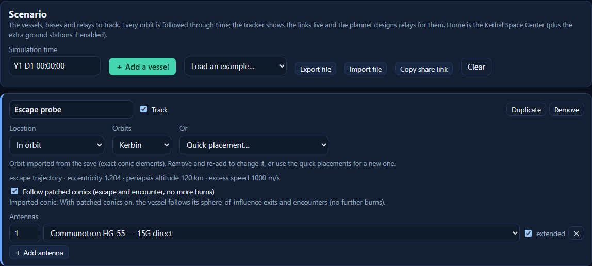
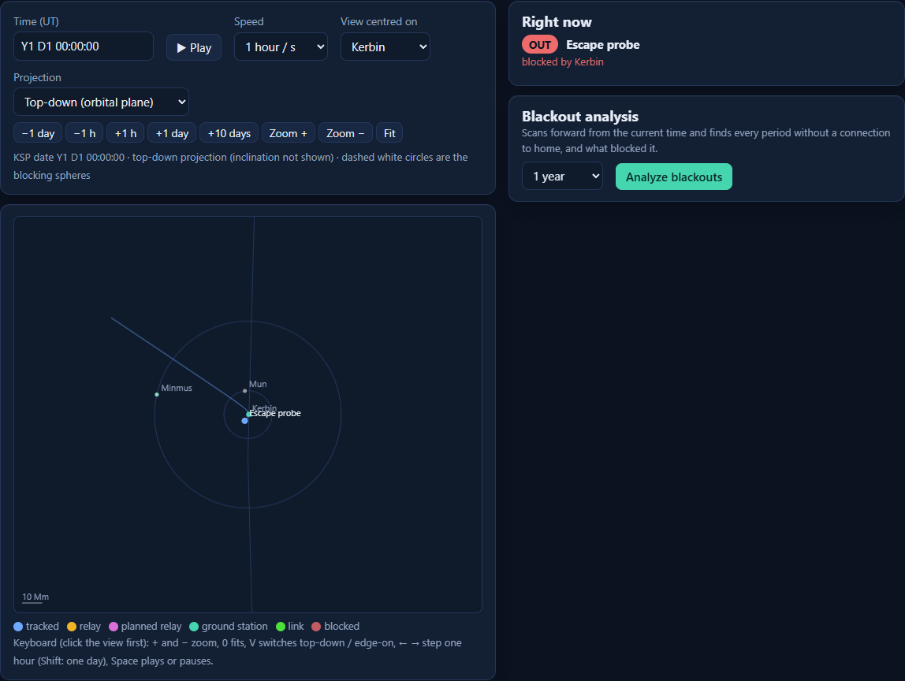

# Scenarios

The **Scenario** tab is the list of vessels, bases and relays that the [Tracker](tracker.md) follows through time and
the [Relay planner](planner.md) designs for. Everything on those two tabs starts here.

## Vessels

Each card is one vessel (a *node*):

* **Name** and **Track.** A *tracked* vessel is one you need to keep in contact with: the Tracker shows its connection
  and the planner works to fix its outages. An unticked vessel is a *relay*: it carries signals for the others but is not
  itself a goal.
* **Location** is *In orbit* around any body (the Sun included) or *Landed / on a surface*.
  * **In orbit:** periapsis and apoapsis altitude (type them with units, `300 km`), inclination, longitude of the
    ascending node (LAN), argument of periapsis and the phase (mean anomaly) at UT 0.
  * **Landed:** latitude, longitude and altitude. Longitudes count east from the body's prime meridian.
* **Quick placement…** fills the location from a template: low Kerbin orbit, keostationary orbit parked over the KSC,
  a 100 km Munar orbit, a Kerbin-like solar orbit 60° ahead of or behind Kerbin, landed at the KSC, or on the near or far
  side of the Mun.
* **Antennas** are a count and a part each, with an *extended* checkbox (a retracted antenna does not count). If the
  Near Future Exploration pack is on, an antenna that has a feed can also be pointed at a **reflector**.
* **Duplicate** and **Remove** do what they say.

Below the card a summary line gives the period, eccentricity and semi-major axis, and a message appears if something is
wrong (a periapsis below the surface or inside the atmosphere, an apoapsis outside the sphere of influence).

**Simulation time** is the instant the Tracker starts at, in KSP's calendar (`Y1 D1 00:00:00`). **Load an example…**
replaces the scenario with a ready-made one (a Duna orbiter, the far-side Mun lander, a Laythe base with a Jool relay).

## Home is the DSN

The links end at the Kerbal Space Center, plus the extra ground stations if you turned them on in
[Game settings](settings-and-mods.md). Kerbin's rotation carries the stations around, so Kerbin's own night side
cuts a distant link for hours every day unless a relay or extra stations help.

## Importing your real fleet

Load your `persistent.sfs` from the Game settings panel (the file is read in your browser, nothing is uploaded). The
Scenario tab then offers:

* **Add a vessel from "your save"…** for one vessel at a time,
* **Add all vessels with antennas**, which skips debris, flags and anything without an antenna,
* **Use the save's current time**, to start the simulation at the save's UT.

Orbits and antennas come across exactly, as long as the body is one the app knows (stock bodies, and OPM when it is
enabled). Vessels that sit in an orbit the app cannot read are listed but greyed out with the reason.

## Escape trajectories and patched conics

KSP moves a vessel along one orbit at a time and hands it to the next body when it crosses a sphere-of-influence edge.
Tick **Follow patched conics** on a vessel to do the same: the app finds the exit or encounter, converts the state, and
carries on, up to 16 legs and 25 years ahead by default (both are in the settings panel under *Patched conics*), with no further burns.

* A vessel imported from a save on an **escape (hyperbolic) orbit** is kept as its exact orbit and has this option on.
* A **transfer orbit** that crosses its body's sphere-of-influence edge is imported with the option on.
* Without the option a vessel stays on one orbit about its body, and a message warns you if that orbit leaves the sphere
  of influence.

The Tracker draws each leg of the trajectory about its own body:

Without burns this is the path the vessel takes if it does nothing more. To plan a transfer, add **manoeuvres** to the
vessel (below).

## Manoeuvres

An orbiting vessel has a **Manoeuvres** list. **Add a burn** gives it a time and a prograde, normal and radial speed
change in m/s (prograde along the velocity, normal out of the orbital plane, radial away from the body); the card shows
the total. A burn is an instant impulse unless you give it a duration (*lasts s*): it is then flown as short pulses centred on the time, each aimed along the velocity at that moment. Burns are applied in time order; after the last one the vessel follows its patched conics,
so a transfer, a capture or an escape appears in the Tracker and in every link calculation. Up to 12 burns per vessel
are kept, and they are part of exports and share links. Use the [Launch windows](launch-windows.md) tab to find when to
burn and how much.

## Export, import and share links

* **Export file** downloads the scenario (and the settings that matter) as `ksp-commnet-scenario.json`.
* **Import file** loads such a file. **Copy share link** copies a link that carries the whole scenario in its address;
  open it and the app offers to load the scenario. Links are compressed in your browser and nothing is uploaded.
* Imports are treated as untrusted input: every field is validated and range-checked, unknown antennas are kept but
  ignored with a warning, and the app always asks before replacing what you have, and says if the file also changes your game settings.

Because the scenario lives in your browser's storage, export a file if you want a backup or to move it to another
computer.
