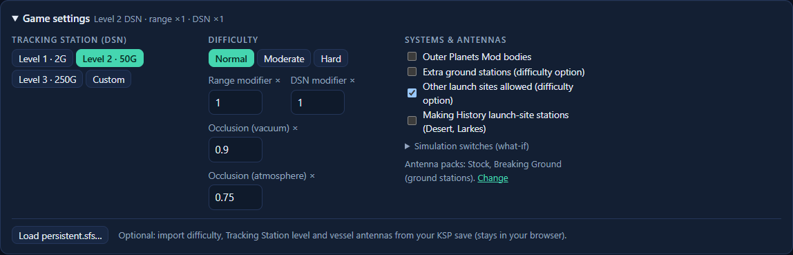
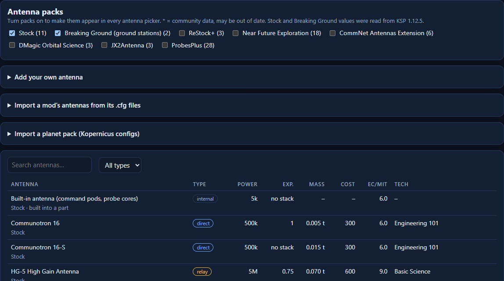

# Game settings and mods

Everything the maths depends on that is not a vessel: your difficulty, the Tracking Station, which bodies and stations
exist, and which antennas are available.

## Game settings

The panel at the top of every tab. It also shows a one-line summary when collapsed.

| Setting | What it does |
|---|---|
| **Tracking Station (DSN)** | Level 1, 2 or 3 gives the DSN a rating of 2G, 50G or 250G. *Custom* lets you type one. |
| **Difficulty** | *Normal*, *Moderate* or *Hard* fill in the four modifiers below. Edit any of them for a custom difficulty. |
| **Range modifier** | scales every vessel's antenna power (Normal ×1, Moderate ×0.8, Hard ×0.65) |
| **DSN modifier** | scales the DSN's rating |
| **Occlusion (vacuum / atmosphere)** | scales the blocking sphere of airless bodies and of bodies with an atmosphere (Normal 0.9 / 0.75, Moderate 1.0 / 0.85, Hard 1.0 / 1.0) |
| **Outer Planets Mod bodies** | adds Sarnus, Urlum, Neidon, Plock and their moons, and moves Eeloo to orbit Sarnus, as the mod does |
| **Extra ground stations** | the difficulty option *Enable Extra Groundstations*: six more stations on Kerbin (the five anomaly dishes and Baikerbanur), all at the DSN rating |
| **Other launch sites allowed** | the game's *Allow Other Launch Sites* option |
| **Making History launch-site stations** | the two weak (40G) fixed stations at the Desert and Larkes launch sites that the Making History expansion adds |
| **Simulation switches (what-if)** | *Kerbol blocks signals* (on, as in the game) and *Atmosphere height counts toward blocking size* (off, as in the game). Change them only for experiments. |

The model behind these is in [How the model works](model.md).

### Load persistent.sfs

**Load persistent.sfs…** reads your KSP save file in the browser (it is never uploaded) and copies your difficulty, your
Tracking Station level and the antennas on your vessels. The [Scenario](scenario.md) tab then lets you add your real
vessels, orbits and all. The save stays in your browser's storage until you reset the app.

Your saves are in the KSP install folder under `saves/<your save>/persistent.sfs`. The app only reads the file; it never
modifies your game.

## Antennas and mods

The **Antennas & mods** tab holds the antenna data used by every picker.

### Antenna packs

Turn a pack on and its antennas appear in every antenna picker; turn it off and they disappear. Stock and Breaking
Ground values were read from the KSP 1.12.5 part configs. The mod packs are ReStock+, Near Future Exploration, CommNet
Antennas Extension, DMagic Orbital Science, JX2Antenna and ProbesPlus; their values come from each mod's current part
configs and are re-checked by script monthly (see [Development](development.md#data)).

The table below the sections lists every antenna with its type (direct, relay or internal), power, combinability exponent,
mass, cost, electric charge use and the tech node that unlocks it. "no stack" means the antenna does not combine with
others.

### Add your own antenna

Give it a name, a type, a power, an exponent, a mass and a cost. It joins a *custom* pack and appears in every picker.

### Import a mod's antennas from its .cfg files

Open the mod's part folders in `GameData`, select the antenna `.cfg` files (or paste one), and press **Read antennas**.
Anything with a `ModuleDataTransmitter` is picked up: power, relay or direct, combinability, mass and cost. Name the
pack and add it. A part that does not say `antennaCombinable` is treated as non-combinable, as in the game.

### Import a planet pack (Kopernicus configs)

Select the pack's body `.cfg` files from `GameData/<pack>/…` (or paste one) and press **Read bodies**. Bodies with a
complete `Properties` and `Orbit` are added to the distance pickers, the Scenario and the simulation, and patches to
existing bodies are applied. The app reports what it found and what it could not use. Spin phase and station positions
for a pack's bodies are only as exact as the pack states them; where a pack gives no starting rotation, an
approximation is used.

Bodies the pack **redefines** (same name as a stock body) replace the stock ones. A pack that defines its own Kerbin, such
as **Real Solar System**, replaces the whole stock system: the stock bodies it does not redefine are dropped, the star
is patched, degree-valued mean anomalies (`meanAnomalyAtEpochD`) and relative edits such as `@radius *= 1.02` (oblate
planets) are applied, and the calendar switches to Earth time (24-hour days, 365-day years) so that "1 year" means a
real year. Menu-manager filters (`@Body:HAS[…]`) are ignored. The app has been run against the real Real Solar System
configs: all bodies import and the planner, tracker and network tabs work on an Earth-sized system, including the
keostationary relay height.

A pack that **rescales the home world** is handled too: JNSQ imports with no warnings, the
calendar follows the home world's day, a body's `displayName` (with its `^N` gender mark) becomes its name, and gas giants defined from the Jool,
Sarnus, Urlum or Neidon templates are recognised so that landers are not planned on them. `node scripts/check-planet-pack.js` runs the real JNSQ
configs (a shallow clone of its public repository, nothing copied into this repository) through the importer, the world, the planner and the
simulator; the monthly workflow does the same. The Reentry tab always uses the stock bodies and atmospheres, even with a pack loaded.

JNSQ also changes **CommNet itself**: its config patches every antenna's `antennaPower` to four times the stock value, and its notes recommend a
DSN modifier of 4 and a range modifier of 1 at its quarter-real scale. The workbench does not apply that patch for you. Use the Game settings
difficulty fields (range and DSN modifiers) or a custom antenna to match what your game does.

### Near Future reflectors

With the Near Future Exploration pack on, an antenna entry that has a feed gets a **reflector** picker. Choose the
reflector it points at and its range bonus (`bonus × the feed's scale`) is added, as the game does.
