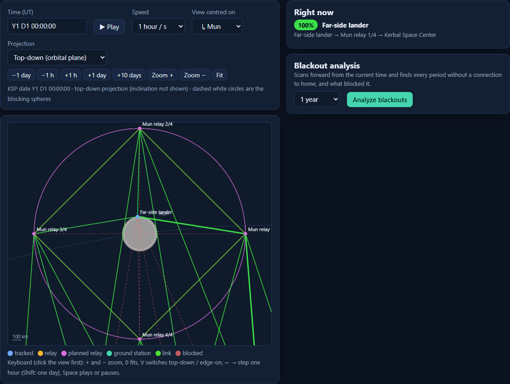
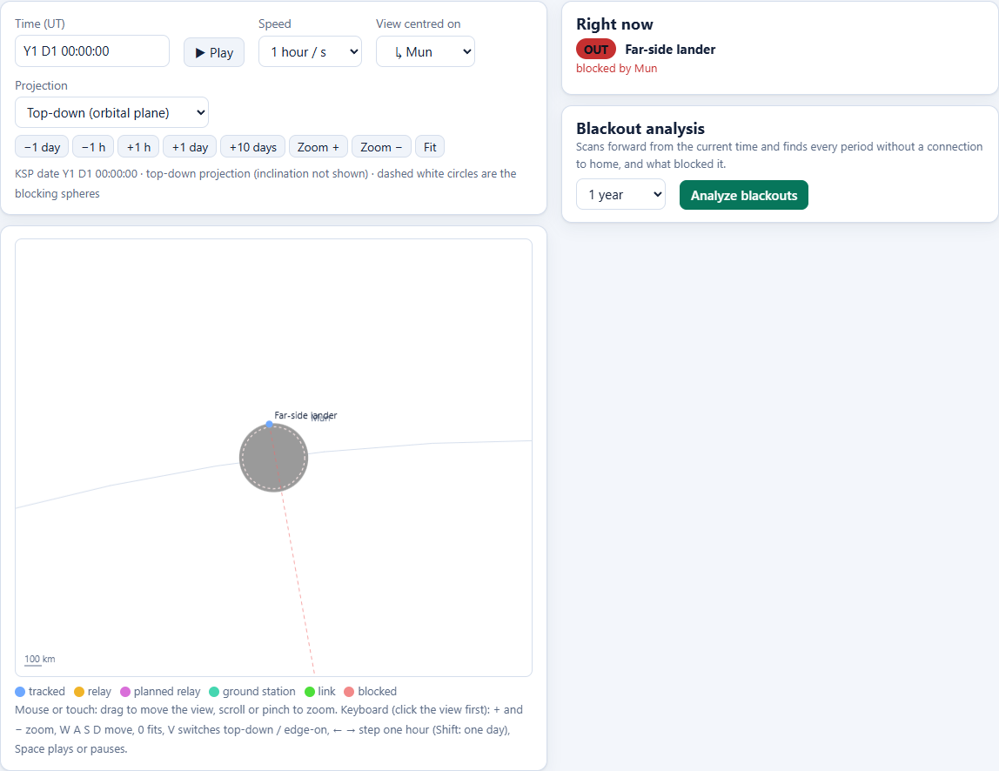
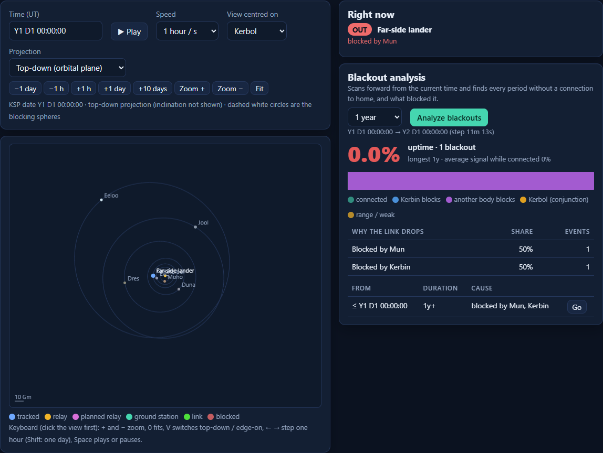
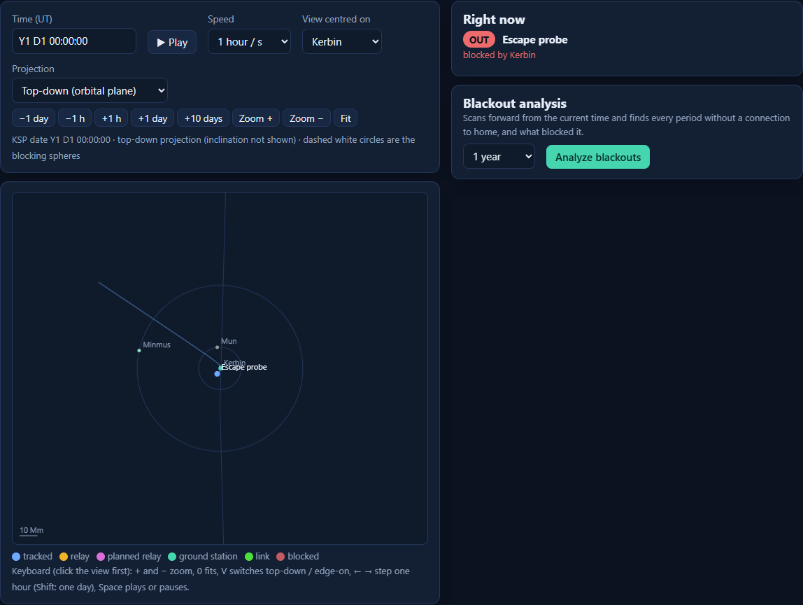

# Tracker

Watch the system move, see which links are up and which body is in the way, and find every future blackout.
It follows the vessels from your [Scenario](scenario.md).

## The view

The canvas shows the bodies, their orbits, your vessels and the links between them.

| What you see | Meaning |
|---|---|
| Blue dot | a tracked vessel |
| Yellow dot | a relay you placed |
| Magenta dot and orbit | a relay the planner designed (see [Relay planner](planner.md)) |
| Teal dot | a ground station |
| Green line | a working link (brighter and thicker on the active path) |
| Red dashed line | a link that range would allow but a body blocks |
| Dashed white circle | a body's **blocking sphere**: its radius times the occlusion modifier |

The line between two points is blocked exactly when it touches one of those spheres, so you can read blackouts straight
off the picture.

**Controls.**

* **Time (UT)** takes a date in KSP's calendar (`Y1 D1 00:00:00`). **Play** runs time at the **Speed** you pick, from one
  minute per second up to a year per second. The −1 day, −1 h, +1 h, +1 day and +10 days buttons step it.
* **View centred on** follows any body; **Zoom +**, **Zoom −** and **Fit** change the scale (the scale bar is in the
  corner). **Drag** the view to move it, and **scroll** (mouse) or **pinch** (touch screen) to zoom; **Fit** puts it back.
* **Projection** is *Top-down (orbital plane)* or *Edge-on*, which shows inclination.
* **Keyboard** (click the view first): `+` and `−` zoom, `W` `A` `S` `D` move the view, `0` fits, `V` switches
  projection, `←` and `→` step one hour (hold Shift for one day), `Space` plays or pauses.

The app follows your system's light or dark theme; the colours meet WCAG AA contrast in both. On a phone or tablet the
tracker works by touch (drag to move, pinch to zoom).

The **Right now** card gives each tracked vessel's state at the current time: the signal and the path to home
(`Far-side lander → Mun relay 1/4 → Kerbal Space Center`), or **OUT** and what blocks it.

## Blackout analysis

Press **Analyze blackouts** to scan forward from the current time (a month up to eight years) and list every period
without a connection.

* The headline gives **uptime**, the number of blackouts, the longest one and the average signal while connected.
* The **timeline** colours every moment: connected, blocked by Kerbin, blocked by another body, blocked by Kerbol (a
  conjunction), or range / weak signal.
* **Why the link drops** shares the downtime among causes, with the number of separate events.
* The list gives each blackout's **start, duration and cause**, and **Go** jumps the view to it.

The scan steps through time and then refines every start and end by bisection to about half a second, so the durations
are exact rather than limited by the step. A three-year scan takes a fraction of a second.

## Patched conics

A vessel set to follow patched conics is drawn as a trajectory, each leg about its own body, ending in the next body's
orbit. See [Scenarios](scenario.md#escape-trajectories-and-patched-conics).

## Reading a blackout

The cause tells you the cure, which is what the [Relay planner](planner.md) automates:

| Cause shown | What it means | Usual cure |
|---|---|---|
| Blocked by Kerbin | the KSC is on the night side from the vessel's point of view | relays in Kerbin orbit, or extra ground stations |
| Blocked by the body you orbit or sit on | the vessel is on the far side or behind it | a relay ring around that body |
| Blocked by Kerbol | solar conjunction | relays in Kerbin's orbit 60° ahead or behind |
| Out of range | too far for the antennas | more antenna power or a relay in between |
| Weak signal | connected, but below your minimum | more antenna power |
